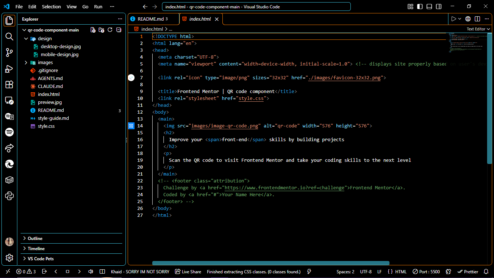
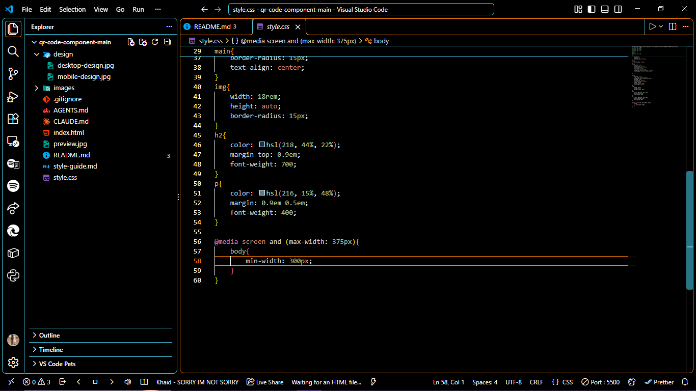

# Frontend Mentor - QR Code Component

This is my solution to the [QR code component challenge on Frontend Mentor](https://www.frontendmentor.io). The challenge is to build a small, centered card that shows a QR code with a short heading and description, and to make it look right on both mobile and desktop screens.

## Table of Contents

- [Frontend Mentor - QR Code Component](#frontend-mentor---qr-code-component)
  - [Table of Contents](#table-of-contents)
  - [Overview](#overview)
  - [Screenshots](#screenshots)
    - [HTML (`index.html`)](#html-indexhtml)
    - [CSS (`style.css`)](#css-stylecss)
  - [Features](#features)
  - [Built With](#built-with)
  - [Project Structure](#project-structure)
  - [Design Details](#design-details)
    - [Colors](#colors)
    - [Typography](#typography)
    - [Layout Widths](#layout-widths)
  - [Getting Started](#getting-started)
  - [What I Learned](#what-i-learned)
  - [Possible Improvements](#possible-improvements)
  - [Author](#author)
  - [Acknowledgments](#acknowledgments)

## Overview

The component is a single white card, centered on a light blue-grey page. Inside the card are three things:

1. A QR code image with rounded corners
2. A bold heading: "Improve your front-end skills by building projects"
3. A short paragraph telling visitors to scan the code to visit Frontend Mentor

The goal of the project was to practice the basics of HTML and CSS: semantic markup, Flexbox centering, working with a design style guide, and making a layout hold up on small screens.

## Screenshots

### HTML (`index.html`)



### CSS (`style.css`)



## Features

- Card centered both horizontally and vertically on the page
- Responsive layout that works from small phones up to large desktop screens
- Rounded corners on the card and the QR code image
- Custom Google Font (Outfit) with a sans-serif fallback
- Colors taken directly from the supplied style guide
- Descriptive `alt` text on the QR code image
- The words "front-end" stay together on one line instead of breaking in the middle

## Built With

- Semantic HTML5
- CSS3 (custom styles, no frameworks)
- Flexbox for layout and centering
- Google Fonts (Outfit, weights 400 and 700)
- A media query for very small screens (375px and below)

## Project Structure

```
qr-code-component-main/
├── design/                  Reference designs for mobile and desktop
├── images/                  QR code image, favicon, and README screenshots
├── index.html               Page markup
├── style.css                All styling
├── style-guide.md           Colors, fonts, and layout widths from the challenge
├── preview.jpg              Challenge preview
└── README.md                This file
```

## Design Details

### Colors

| Name      | Value               | Used for                  |
| --------- | ------------------- | ------------------------- |
| White     | `hsl(0, 0%, 100%)`  | Card background           |
| Slate 300 | `hsl(212, 45%, 89%)`| Page background           |
| Slate 500 | `hsl(216, 15%, 48%)`| Paragraph text            |
| Slate 900 | `hsl(218, 44%, 22%)`| Heading text              |

### Typography

- Font family: [Outfit](https://fonts.google.com/specimen/Outfit)
- Weights: 400 (paragraph) and 700 (heading)
- Paragraph size: 15px

### Layout Widths

The designs were created at 375px (mobile) and 1440px (desktop). The page was also checked across the range in between, down to 320px.

## Getting Started

You do not need to install anything to run this project.

1. Download or clone the repository:

   ```
   git clone https://github.com/GabzzyGold/qr-code-component.git
   ```

2. Open the project folder.
3. Double-click `index.html` to open it in your browser.

An internet connection is needed the first time so the Outfit font can load from Google Fonts. Without it, the page falls back to the default sans-serif font.

## What I Learned

- How to center an element on the whole page using `display: flex`, `align-items`, `justify-content`, and `min-height: 100vh`
- How `box-sizing: border-box` and a CSS reset make sizing more predictable
- How to use `rem` units so spacing and widths scale with the user's font settings
- How `white-space: nowrap` on a `span` keeps a phrase from splitting across two lines
- How to write a media query to protect the layout on very narrow screens
- How to read a style guide and turn its colors, fonts, and sizes into CSS

## Possible Improvements

- Add a footer with the Frontend Mentor attribution and a link to my profile
- Add `:hover` and `:focus` styles if the card is ever made interactive
- Test with a screen reader and keyboard navigation to confirm accessibility
- Replace the fixed card width with `max-width` so it adapts even more smoothly

## Author

- GitHub: [@GabzzyGold](https://github.com/GabzzyGold)
- Frontend Mentor: add your profile link here

## Acknowledgments

Thanks to [Frontend Mentor](https://www.frontendmentor.io) for the challenge and the starter files.